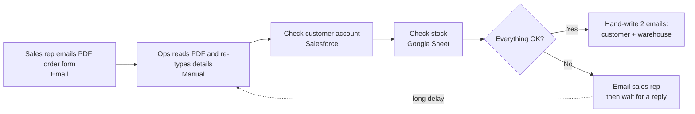
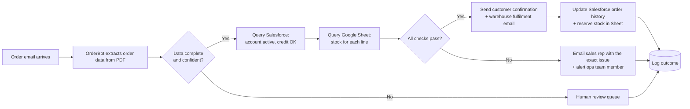

# OrderBot: process analysis and agent design

> Figures marked *target* come from the project brief. Timings and volumes are **assumptions** to be confirmed with Operations.

## 1. Current process (manual)

### Bottlenecks and failure points
| # | Where | Problem | Impact |
|---|-------|---------|--------|
| 1 | Reading the PDF | Details re-typed by hand | Typos, wrong SKU or quantity |
| 2 | Salesforce and Sheet checks | Two systems checked sequentially by a person | Slow; stale data if stock changes meanwhile |
| 3 | Exception path | Problems go back by email and the order waits | Delays of hours or days |
| 4 | Staffing | Orders wait when the ops team member is away | No 24/7 coverage |
| 5 | Drafting emails | Written by hand each time | Inconsistent wording, omitted details |

Questions to confirm with Operations before quoting numbers: orders per day/week, minutes per step, share of orders that hit the exception path, most common exception reasons.

## 2. Proposed solution: OrderBot

### Anatomy of the agent
| Component | OrderBot design |
|---|---|
| **Goal** | Process every new hardware order from email receipt to fulfilment confirmation in under 5 minutes at 99.5% accuracy (*targets*). |
| **Perception (tools)** | Email reader (inbox API); PDF/document parser that extracts customer, SKUs, quantities, delivery details; Salesforce API (read account status, credit hold, contacts); Google Sheets API (read stock levels). |
| **Planning** | 1. Detect new email. 2. Parse PDF into structured order. 3. Validate completeness. 4. Query Salesforce. 5. Query inventory. 6. Decide: *success* plan or *exception* plan. 7. Execute that plan. 8. Log the result. |
| **Action (tools)** | Email sender (customer confirmation, warehouse fulfilment, sales-rep query); Salesforce API (write order history); Google Sheets API (decrement/reserve stock); ticket or alert to the human review queue. |
| **Memory / learning** | Logs every order, decision and outcome. Over time: spot reps who often send incomplete forms, frequent stock-outs, repeat exception reasons; human corrections become test cases and tune extraction and thresholds. |

### Decision rules
| Condition | Action |
|---|---|
| Required field missing or extraction confidence below threshold | Human review queue (do not guess) |
| Customer inactive, on credit hold, or not found | Exception: email sales rep with the specific reason |
| Any line item short on stock | Exception: tell rep which SKU and how many are available |
| Order value above a set limit (e.g. configured by Ops) | Human approval before sending |
| All checks pass | Send both emails, update Salesforce and stock |

## 3. Risks and mitigations
| Risk | Mitigation |
|---|---|
| Misreading a PDF (wrong SKU or quantity) | Confidence thresholds, validation against the product catalogue, human review below threshold |
| Two orders race for the same stock | Reserve stock atomically when approving; re-check just before writing |
| Wrong email sent to a customer | Template-based emails filled from validated data; read-only pilot first; approval mode for early weeks |
| Integration outage (Salesforce, Sheets, email) | Retry with back-off, then park the order in the review queue and alert a person; nothing is silently dropped |
| Malicious or odd emails (prompt injection in PDFs) | Treat attachment text as data, never as instructions; allow-list senders; restricted tool permissions |
| Over-reliance on the agent | Weekly accuracy report, spot checks, clear owner for the process |

## 4. Rollout: read-only Proof of Concept
1. **Shadow mode (read-only):** OrderBot reads real orders and records what it *would* do. It cannot send emails or write to Salesforce or the Sheet.
2. **Compare:** match its decisions against what staff actually did; measure accuracy against the 99.5% target and review every disagreement.
3. **Go / no-go:** if accuracy and exception handling meet the target, move to approval mode (staff click to approve), then phased automation with write access.

Proposed length: about 4 weeks, to be agreed with Operations.

## 5. Reflection
**Biggest risks in the design.** Silent extraction errors (a plausible but wrong SKU), stock races between simultaneous orders, and integration failures that stall orders. These are why the design uses confidence thresholds, validation against master data, atomic stock reservation, and a review queue as a safe fallback.

**Where human oversight stays critical.** Exceptions and low-confidence orders, high-value orders, new or unusual customers, and ownership of the thresholds and rules themselves. A person must also review accuracy reports, because an agent can be consistently wrong without anyone noticing.

**How the developer's role changes.** The shift from writing code to specifying systems: defining goals, tool permissions, failure modes and acceptance tests, then reviewing what AI produces. The highest-value work is judgement about what to build, how to make it safe, and how to explain it to the business.
