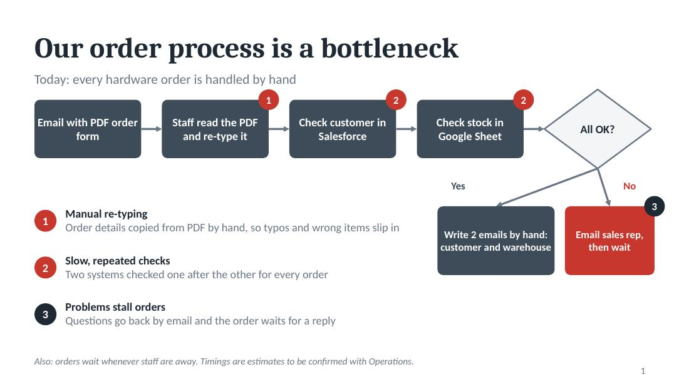
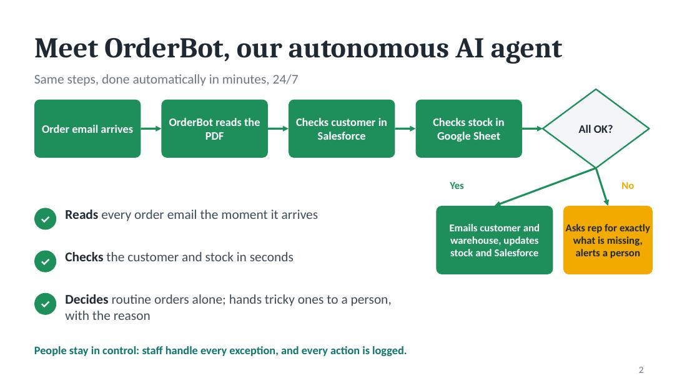
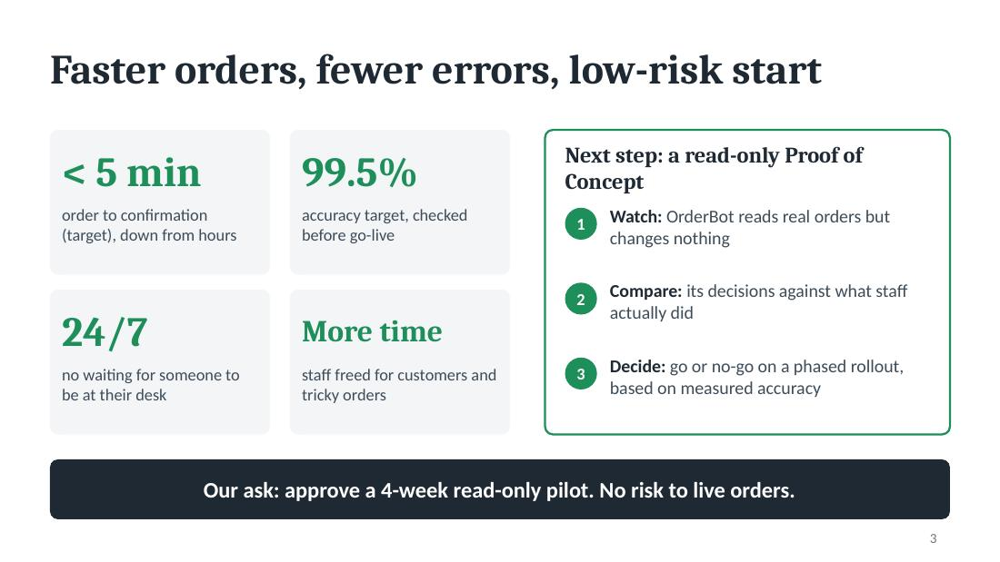

# Task 3: OrderBot, an agentic AI design for hardware order processing

A conceptual design (no code) for an autonomous AI agent that replaces a manual order-handling process
(email PDF, Salesforce check, Google Sheet stock check, hand-written emails), plus a 3-slide management presentation.

| Deliverable | File |
|---|---|
| 3-slide presentation (PowerPoint) | [`OrderBot_Presentation.pptx`](OrderBot_Presentation.pptx) (PDF copy: [`OrderBot_Presentation.pdf`](OrderBot_Presentation.pdf)) |
| Agent design, flowcharts, risks, reflections | [`ORDERBOT_DESIGN.md`](ORDERBOT_DESIGN.md) |
| Script that generates the deck | [`build_deck.js`](build_deck.js) (`pptxgenjs`) |

